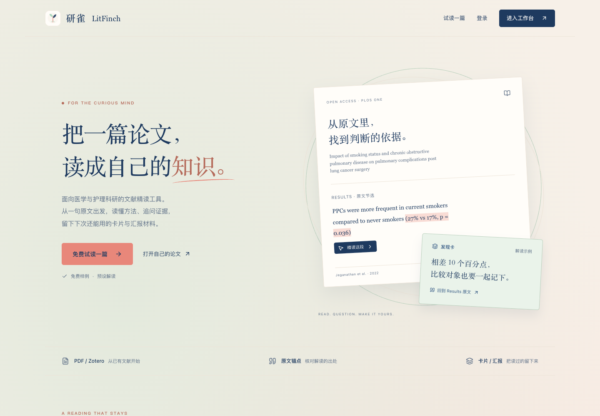
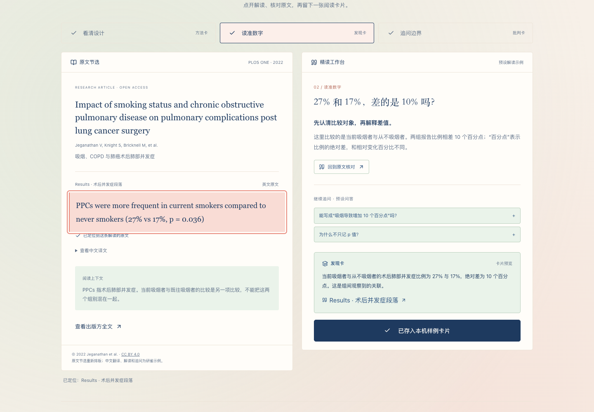

# 研雀 · LitFinch

面向医学与护理科研的论文精读工具。从 PDF 原文出发，梳理研究设计、追问证据，整理可回溯的阅读卡片与汇报材料。

[在线体验](https://papermindapp.com/welcome) · [免费试读](https://papermindapp.com/demo) · [Zotero 插件源码](https://github.com/lvyrana/papermind-zotero) · [问题反馈](https://github.com/lvyrana/papermind-source/issues)

网站本体版本：**[v0.17.0 · 云端迁移版](https://github.com/lvyrana/papermind-source/releases/tag/v0.17.0)**（2026-10-24）。[更新说明](docs/releases/v0.17.0.md)涵盖云端存储、持久任务、账号、备份及部署方式。本体与 Zotero 插件独立编号；插件当前版本为 0.7.1。


## 看看研雀怎么用

从免费试读开始，先看清原文、核对解读，再留下一张带出处的卡片。



免费试读把原文与解读并排展示。点击「回到原文核对」定位证据，样例卡片可保存并导出为 Markdown。



截图来自 2026-10-22 的实际前端构建。试读内容为开放论文节选与预设解读；来源和许可见[截图说明](docs/screenshots/README.md)。正式工作台支持打开自己的 PDF。

## 两个入口

- **网页版（本仓库）**：React 前端、Python/FastAPI 后端；本地使用 SQLite，云端支持 Vercel + Turso + 私有 Blob。支持上传 PDF、论文检索、精读和汇报导出。
- **Zotero 客户端（独立仓库）**：在 Zotero 内阅读、追问和整理卡片，也可将论文送入网页版。下载 [0.7.1 稳定包](https://github.com/lvyrana/papermind-zotero/releases/tag/v0.7.1)手动安装；旧用户自动更新清单保持 0.3.0。

2026-10-16 源码包含已上线的产品首页、免费试读、Zotero 身份登录、统一配色和设置页精简。网站与插件沿用原 PaperMind 技术标识，显示名称为「研雀 · LitFinch」。插件本地阅读记录与网页记录分别保存。

2026-10-23：正式网站已迁至 Vercel，原网址不变；当前源码包含私有文件直传、持久任务、共享预算、云端备份和 Vite 8.3.5。部署步骤见 [云端部署与维护](docs/vercel-deployment.md)。插件 0.7.1 已在 macOS / Zotero 9.0.6 完成真实登录、进程重启恢复、PDF 上传和退出验收。Windows、Linux 与其他 Zotero 版本尚未原生验收。

## 核心功能

- PDF 精读：翻页、缩放、划词翻译与追问、原文高亮和页码回跳。
- 阅读带读：整篇路线、摘要与当前页阅读，回答可保存为笔记。
- 阅读卡片：方法、发现、批判和迁移，带原文出处。
- 汇报整理：卡片与笔记进入汇报板，导出 PowerPoint 或 Markdown。
- 苏格拉底自测：围绕研究问题、方法、结果与局限追问。
- 个人书架、笔记、对话记录及 Zotero 身份登录。

免费试读使用标注来源和许可的开放论文节选，解读为预设内容。正式精读由所配置的模型服务生成。

## 自行运行

需要 Python 3.12，以及 Node.js 22.13+（22.x）或 Node.js 24 LTS。后端支持 Linux/macOS；Windows 使用 WSL2。

```bash
git clone https://github.com/lvyrana/papermind-source.git
cd papermind-source
python3.12 -m venv papermind/.venv_new
papermind/.venv_new/bin/python -m pip install --upgrade pip==26.2.1
papermind/.venv_new/bin/python -m pip install --require-hashes -r papermind/requirements.lock
cp -n papermind/.env.example papermind/.env
```

在 `papermind/.env` 填入自己的模型服务 API Key，例如 `QWEN_API_KEY`、`GLM_API_KEY` 或 `DEEPSEEK_API_KEY`。模板中的密钥均为空；AI 请求使用部署者配置的服务。

```bash
papermind/.venv_new/bin/python scripts/deployment_preflight.py
(cd web && npm ci --ignore-scripts && npm run build)
(cd papermind && .venv_new/bin/python -m uvicorn api:app --host 127.0.0.1 --port 8000)
```

打开 `http://127.0.0.1:8000/welcome`。仅体验首页和样例时，前端可单独运行：`cd web && npm ci --ignore-scripts && npm run dev`。

Zotero 登录为可选配置。自部署者在自己的 Zotero 账号下登记应用，设置站点地址和 `/api/auth/zotero/callback` 回调；具体配置见 [账号登录](docs/zotero-login.md)。上线域名、HTTPS、邀请与预算参数见 [部署与恢复](docs/deployment-recovery.md)。

## 测试与维护

```bash
papermind/.venv_new/bin/python scripts/test_backend_isolated.py
papermind/.venv_new/bin/python scripts/smoke_backend.py
(cd web && npm test && npm run build && npm run lint)
(cd web && npm run test:pdf-reader && npm run test:accounts && npm run test:public-entry)
```

完整后端测试还需要云端可选 SDK：`papermind/.venv_new/bin/python -m pip install --require-hashes -r deploy/vercel-preview/requirements.txt`。浏览器检查使用 Playwright；通过 `PAPERMIND_CHROMIUM_EXECUTABLE` 指定已有 Chrome/Edge，或安装 Playwright Chromium。测试使用独立资料目录和合成数据。GitHub Actions 执行后端、前端、依赖审计与三组浏览器检查。

本地模式的业务数据保存在 `papermind/data/`。本地完整备份包含数据库、上传附件和已有账号归属库；云端使用独立的 [备份与恢复流程](docs/vercel-deployment.md#备份与恢复)：

```bash
bash scripts/backup_local.sh
python3.12 scripts/backup_data.py verify backups/snapshot-实际名称
```

服务器配置、模型密钥、用户论文、数据库和备份不随源码分发。点击 AI 操作时，相关论文内容会发送到所配置的模型服务。诊断服务默认关闭，可通过部署配置启用。

## 文档与贡献

- [精读功能说明](docs/deep-reading-overview.md)
- [部署、备份与恢复](docs/deployment-recovery.md)
- [Vercel 云端部署](docs/vercel-deployment.md)
- [Zotero 登录](docs/zotero-login.md)
- [变更记录](CHANGELOG.md)与[技术决策](DECISIONS.md)
- [第三方声明](THIRD_PARTY_NOTICES.md)

提交问题时附上版本、操作步骤和错误提示。欢迎通过 Issue 或 Pull Request 提交修复与改进。

## 许可

主项目原创代码采用 **AGPL-3.0-only**，完整条款见 [LICENSE](LICENSE)。第三方代码与素材保留各自许可，见 [THIRD_PARTY_NOTICES.md](THIRD_PARTY_NOTICES.md)。Zotero 客户端在独立仓库维护并附带其许可证。

由雀雀主导产品设计、需求、测试与迭代，使用 AI 编程工具辅助实现。保留现有作者署名。
